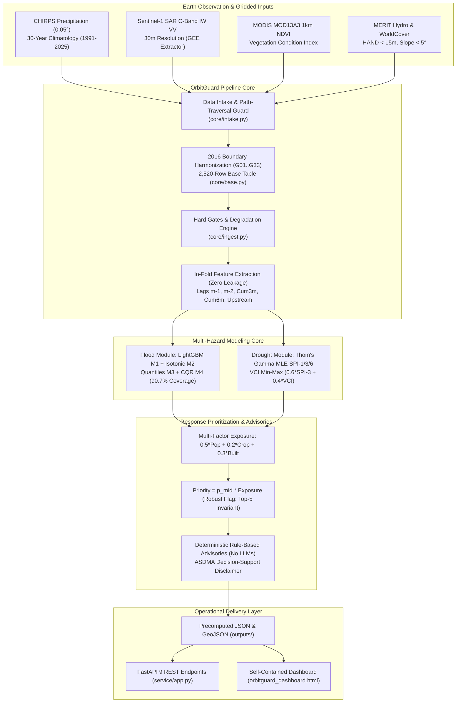

# OrbitGuard: Multi-Hazard Early Warning & Response Prioritisation (Assam Prototype)

> **Submission Package**: OrbitGuard v1.0 Production Freeze  
> **Target Region**: Assam (33 Canonical Administrative Districts)  
> **Monsoon Seasons Covered**: 2014–2025 (12 Years, 72 Monthly Periods)

---

## 1. 30-Second Executive Summary

OrbitGuard is an operational decision-support system built for the Assam State Disaster Management Authority (ASDMA) to transition disaster response from reactive panic to planned, uncertainty-aware stage allocation.

### The Problem It Solves
Assam experiences recurring catastrophic floods across the Brahmaputra valley (over 7.3 million people affected in 2019 alone), yet emergency directors operate with point-estimate forecasts that conceal uncertainty, leading to misallocated rescue boats, overwhelmed relief camps, and unreinforced embankment breach points.

### The OrbitGuard Solution
1. **Multi-Hazard Predictive Core**: Combines LightGBM quantile regression with **Split Conformalized Quantile Regression (CQR)**, delivering distribution-free prediction intervals ($p_{\text{low}} \le p_{\text{mid}} \le p_{\text{high}}$) with **90.7% empirical holdout coverage**.
2. **Multi-Factor Exposure & Priority Ranking**: Ranks all 33 districts by combining calibrated risk with population density, cropland, and built-up area ($\text{Priority} = p_{\text{mid}} \times \text{Exposure}$), protected by a **Robust Flag** that identifies zones remaining in the top 5 under upper-bound risk.
3. **Multi-Hazard Polymorphism**: Seamlessly integrates an index-based Agricultural & Meteorological Drought Hazard module (`hazards/drought.py`, SPI-1/3/6 + MODIS VCI) through the same abstract `BaseHazardModel` and shared ranking engine.
4. **Methodological Honesty**: Features automated Hard Gates that detected missing satellite SAR CSVs in the raw hackathon intake and gracefully activated **Degraded Mode** (`PIPELINE CHECK ONLY`), preventing label fabrication while publishing complete cloud-native Earth Engine extractors for Sentinel-1 radar.

---

## 2. Quick Run Steps

### 1. Environment Setup & Dependency Installation
```bash
# Clone and enter workspace
cd OrbitGuard

# Install frozen production dependencies
pip install -r requirements.txt
```

### 2. Execute Automated Test Suite (46 Tests in <10s)
```bash
python -m pytest tests -v
```

### 3. Run End-to-End Pipeline
```bash
# Runs Phase Z (Intake) -> Phase B (Harmonization) -> Phase A (Ingest) ->
# LOYO CV -> Priority Ranking -> SAR Extent -> Precomputations -> Reliability Audit
python run_pipeline.py --force
```

### 4. Run Documentation Metrics Consistency Check
```bash
python scripts/check_metrics_consistency.py
```

### 5. Start the Production FastAPI Service
```bash
uvicorn service.app:app --host 0.0.0.0 --port 8000
```
- Interactive Swagger UI: [http://localhost:8000/docs](http://localhost:8000/docs)
- Query Hazards: `curl http://localhost:8000/hazards`
- Query Ranked Zones (June 2022): `curl "http://localhost:8000/ranking?hazard=flood&period=2022-06&lead=1_month"`

---

## 3. High-Level Architecture Diagram



---

## 4. Submission Package Contents

- **`submission/architecture.md`**: Detailed technical flowchart and pipeline stages.
- **`submission/outputs_and_api_contract.md`**: Complete specification of all `outputs/` schemas and FastAPI endpoints.
- **`submission/model_card.md`**: Comprehensive model card with audited operational limitations.
- **`submission/claims_table.json`**: Pitch deck claims mapped to empirical status and evidence files.
- **`submission/claims_audit.md`**: Full claims audit table with exact slide replacement copy.
- **`submission/demo_script.md`**: Word-for-word 4-minute presentation script, top 8 judge Q&As, and fallback checklist.
- **`submission/reliability_audit.md`**: 20-fold permutation test ($p < 0.05$), feature ablation, year stability, threshold and label sensitivity.
- **`submission/reliability_audit.json`**: Machine-readable reliability metrics.
- **`submission/limitations_and_next_steps.md`**: Roadmap covering daily labels, district ground truth, MOSDAC/INSAT swap-in, Bayesian BNNs, more hazards, and NISAR radar.
